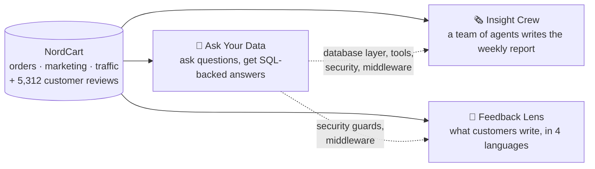

# Hi, I'm Minal 👋

**AI engineer in training** (Turing College AI Engineering programme), building practical LLM applications with
**LangChain, LangGraph, RAG and Streamlit**, and measuring them with real evaluations.

---

## 🛒 NordCart: three AI systems for one company

NordCart is a fictional online shop selling in six European countries. I gave it realistic data with **business
problems hidden on purpose** (a mobile-app checkout bug, a cut marketing budget, a courier strike in Poland) and
built three AI systems that look at the same company from three angles. Because I planted the problems, I know the
right answers, so every system is **evaluated against ground truth**, not judged by eye.

| Project | The question it answers | Key techniques | Measured result |
|---|---|---|---|
| [**Ask Your Data**](https://github.com/MinalBorse/Ask-Your-Data) | "What happened, and why?" | LangGraph workflow + ReAct agent, 9 tools, hybrid RAG, human-approved investigation plans, 6 security layers | Router **100%**, tool choice **92%**, RAG faithfulness **0.96**; few-shot SQL prompts **88%** vs chain-of-thought 25% |
| [**Insight Crew**](https://github.com/MinalBorse/Report-Insignt-Crew) | "What does leadership need to know this week?" | Multi-agent LangGraph (planner, parallel analysts, writer, critic), code-based fact-checking, human review, PDF publishing | **9 of 9** planted errors caught; honest comparison: the crew is **10× the cost** of a single agent for similar quality: its value is control |
| [**Customer Intelligence: Feedback Lens**](https://github.com/MinalBorse/Customer-Intelligence-Feedback-lens) | "What are customers telling us?" | Batched LLM classification, multilingual embeddings, clustering, trend alerts, citation-verified Q&A, prompt-injection quarantine | Incidents found as themes **99–100%**; sentiment **95%**; topics F1 **0.92** (mini) at $0.13 per 1,000 reviews |

**The same incident, seen three ways:**

| Planted incident | Ask Your Data | Insight Crew | Feedback Lens |
|---|---|---|---|
| App checkout bug, March 2026 | Agent traces app orders −85% to release v4.2 | Weekly report leads with it | Theme "Pay Now Button Unresponsive" (99%) |
| Courier strike, Poland, January 2026 | Cancellation spike isolated to PL | States "cause unknown" instead of guessing | Polish delivery complaints, alert for PL |
| Electronics price +12%, May 2026 | Higher price, fewer units | Covered in the report | Theme "Sudden 12% Price Hike" (99%) |

**What I learned building them**

- **Numbers come from code, words from the LLM, and code checks the words.** Every project verifies the AI's
  numbers or citations before showing them.
- **Measure, don't assume.** Few-shot examples beat "think step by step" for SQL (88% vs 25%); a cheaper model was
  better at sentiment but worse at topics; a multi-agent crew did not beat a single agent on quality.
- **Use an agent only where the next step depends on the input.** Batch processing is a pipeline; questions are agents.

---

## 📈 Other projects

| Project | What it does |
|---|---|
| **Portfolio Pilot** | Long-term portfolio analysis: true returns (time- vs money-weighted), ETF look-through, Monte Carlo goal projections, German tax estimates, and an honest backtest of buy/sell rules after fees and tax |
| **18P Analyst** | My own 18-point fundamental stock-analysis framework and a valuation & allocation framework turned into an app, with free data sources and code-verified AI output |

---

## 🧰 Tools

Python · uv · LangChain · LangGraph · OpenRouter (GPT-5 family) · Streamlit · SQLite · ChromaDB · BM25 / hybrid retrieval ·
scikit-learn · pandas · Plotly · pytest · GitHub Actions · MCP · Claude Code

*All projects use synthetic or public data. No API keys are stored in any repository.*
